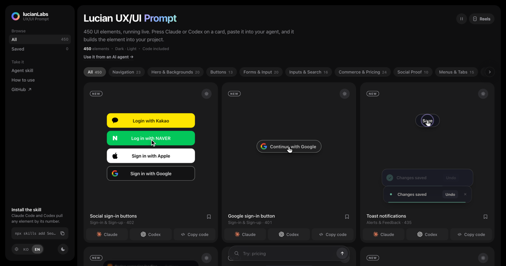

[🇰🇷 한국어](README.ko.md) · [🇺🇸 English](README.md)

# Lucian UX/UI Prompt



450 interactive UI elements you can try live, then take into your project as an AI prompt or as working code: 50 site essentials every website needs (Google and social sign-in, cookie banner, header, pricing, FAQ, checkout…), 200 website sections and animations, and 200 interface parts, from buttons and charts to workflow screens. Every element supports light and dark themes, pointer, touch and keyboard input, and reduced motion. No dependencies.

**Live gallery: [lucianlabs.dev/uxui-prompt](https://lucianlabs.dev/uxui-prompt/)**

## What's inside

All 450 elements live in one library, grouped into 27 categories. Element numbers tell you where they came from:

| Numbers | What they are | Examples |
| --- | --- | --- |
| 401–450 | **Site essentials** (new): production-ready defaults | Google sign-in · social sign-in (Kakao, Naver, Apple, Google) · email sign-in · sign-up · cookie banner and preferences · terms consent · header · footer · hero · pricing · FAQ · toast · confirm modal · date picker · file upload · product card · mini cart · Korean payment methods · coupon |
| 201–400 | Website sections and motion | Text Motion · Hero & Backgrounds · Navigation · Scroll Motion · Sections & Content · Social Proof · Commerce & Pricing · Forms & Input · App Screens · Site Builder Tools · Cursor & Hover · Promos & Rewards · Data Motion |
| 001–200 | Interface parts and work screens | Buttons · Toggles & Pickers · Inputs & Search · Menus & Tabs · Cards & Content · Sign-in & Sign-up · Alerts & Feedback · Loading & Progress · Empty & Error States · Widgets & Charts · Layout, Schedule & Design · Document & Data Editing · Analytics & Data · Workflow & Systems |

In the gallery, **All** starts with the 50 site essentials, then what websites use most (cookie consent, headers, heroes, CTAs, FAQ, pricing, testimonials, footers), then forms and commerce parts, app screens, promos, charts, showcase effects and specialist tools. The order lives in [`src/popular.json`](src/popular.json). Narrow down with the category pills, keep favourites under **Saved** in the sidebar, or use the search bar at the bottom in English or Korean.

## How to use

1. Open the gallery and try an element. Each one plays a short demo when it scrolls into view, and you can take over at any time. Press the expand icon on a card, or **Reels**, to flip through elements full screen.
2. Press **Claude** or **Codex** under the card. The button turns into **Copied**: the prompt contains the element's full working code plus porting instructions.
3. Paste it into your AI coding tool (Claude Code, Codex, Cursor, …), fill in `[Insertion point]` (and `[Replacement target]` if you are replacing something), and send.

The agent first checks your framework, styling and theming setup, then ports the element into a component, maps the `--ux-*` color tokens to your theme variables, and reports what it changed and what it could not check.

If you'd rather port it yourself, **Copy code** on the card gives you the raw HTML, CSS and JS. Press the card's name to read the prompt and code first, or **Download code** to save a standalone HTML file with a theme toggle.

The bookmark on a card saves it under **Saved** in the sidebar (kept in your browser, no account). The sun and moon button switches just that card between light and dark.

To link to a specific element, add its number: `https://lucianlabs.dev/uxui-prompt/#001`.

## Use it from an AI coding agent

Install the [lucian-uxui skill](https://github.com/Seokwoooo/lucian-uxui), and your agent can search the library and port elements by itself:

```sh
npx skills add Seokwoooo/lucian-uxui
```

Then ask something like "Build a landing page for my coffee subscription. Use the lucian-uxui skill and prefer its elements." The skill reads the static data in [`api/v1/`](api/v1), which is generated from `src/elements` and also served at `https://lucianlabs.dev/uxui-prompt/api/v1/`.

## Run locally

All you need is Node.js. There are no packages to install.

```sh
git clone https://github.com/Seokwoooo/lucian-uxui-prompt.git
cd lucian-uxui-prompt
node src/build.mjs
open prompt-uxui-lab/index.html
```

The build checks every element and writes the whole gallery into one self-contained HTML file.

## Element format

Each element is a single file, `src/elements/NNN-slug.html`. Numbers `001`–`200` are interface parts, `201`–`400` website sections and motion, and `401`–`450` site essentials.

```html
<!-- @meta {"title":"…","category":"버튼","summary":"…","hint":"…","shape":"square","tags":["button"]} -->
<!-- @demo [["wait",400],["tap",".u001-btn"],["wait",1200]] -->
<!-- @en {"title":"…","summary":"…","hint":"…","map":[["계속하기","Continue"]]} -->
<style>.u001{…} .u001-btn{…}</style>
<div class="ux u001">…</div>
<script>(() => { const root = document.currentScript.previousElementSibling; … })();</script>
```

- `@meta`: title, category, summary and hint. Korean is the source language, and `category` must be one of the categories listed in [`src/build.mjs`](src/build.mjs). Optional fields: `shape` (`square` or `tall` tile), `hue` and `hue2` (tile glow colors, which default to the category's colors) and `fluid` (the element's width follows its container).
- `@demo`: steps for the autoplay demo: `wait`, `tap`, `hold`, `hover`, `leave`, `glide`, `drag`, `key`, `type`, `erase`, `set`, `scroll`, `reset` and `js`.
- `@en`: English title and summary, plus a string map that localizes the element's code.
- Every CSS selector is scoped to `.uNNN`, `@property` names start with `--uNNN-`, and the script finds its root through `document.currentScript`, so elements never leak into each other.
- Colors come only from the `--ux-*` tokens in [`src/tokens.css`](src/tokens.css), which define both light and dark values.
- [`src/order.json`](src/order.json) sets the display order within a collection, with the most polished elements first. When a collection is listed there, every element in it must appear exactly once.

`node src/build.mjs` rejects any file that breaks these rules.

## License

[MIT](LICENSE) © 2026 Seokwoooo. You can use the elements in personal and commercial projects. Code copied from the gallery starts with a one-line comment that credits the source and names the license. Please keep it in your file.
